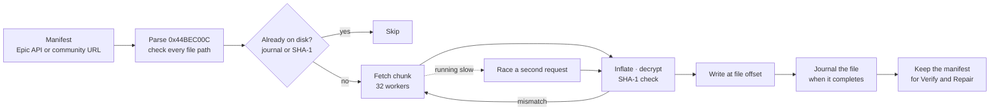

# Hyperion Developer Guide

This is the technical companion to the player-facing [README](README.md). It covers the architecture, download pipeline, protocol notes, security model, and build steps.

## Contents

- [Stack and architecture](#stack-and-architecture)
- [Startup, settings and the tray](#startup-settings-and-the-tray)
- [Download pipeline](#download-pipeline)
- [Protocol notes](#protocol-notes)
- [Verify, repair and updates](#verify-repair-and-updates)
- [Steam integration](#steam-integration)
- [Security model](#security-model)
- [Build and test](#build-and-test)
- [Project layout](#project-layout)
- [Technical FAQ](#technical-faq)
- [Credits](#credits)

<br>

## Stack and architecture

Hyperion is a **Tauri 2** desktop app with a **Rust** core and a **React 19 + TypeScript** interface. The native side owns everything that touches the network, disk or Windows APIs; the frontend renders state and sends typed commands over Tauri IPC.

| Layer | Responsibility |
|---|---|
| `src/` | React UI: Discover, Library, Downloads, Cloud Saves, Account Management, Settings |
| `src/lib/ipc.ts` | Typed wrappers around Tauri commands, plus a mock backend for browser-only development |
| `src-tauri/src/api.rs` | Epic OAuth, auto-renewing session, assets API, manifest fetch and CDN resolution |
| `src-tauri/src/manifest.rs` | Binary manifest parser and serializer |
| `src-tauri/src/manifest_cache.rs` | Community manifest cache and per-install manifests |
| `src-tauri/src/chunk.rs` | Chunk container decoding: zlib inflate and AES-256-GCM |
| `src-tauri/src/downloader.rs` | Parallel, hedged, hash-checked, resumable chunk pipeline |
| `src-tauri/src/installer.rs` | Verify, safe paths and safe uninstall |
| `src-tauri/src/launcher.rs` | Native process launch with Epic arguments |
| `src-tauri/src/cloud_save.rs` | Path-template expansion and cloud-save sync |
| `src-tauri/src/storage.rs` | SQLite persistence for settings, catalog and installed games |
| `src-tauri/src/secret.rs` | DPAPI encryption for the optional remembered Steam password and saved Epic session |
| `src-tauri/src/tray.rs` | Live tray menu: downloads, installed games, show and quit |
| `src-tauri/src/winproc.rs` | `TerminateProcess` and a toolhelp process-tree walk |
| `src-tauri/src/steam/` | SteamCMD driver, Steam library scanner and VDF parser |

The frontend is deliberately thin around the download engine: it starts an install, renders progress events, and sends pause/resume/cancel commands. It does not parse manifests or touch game files.

<br>

## Startup, settings and the tray

The shell renders immediately. On mount, `app_bootstrap(false)` runs in the background to warm the catalog and check SteamCMD state; there is no blocking splash screen. The library request waits only for the saved Epic session check, so the first catalog read already knows whether the account is signed in.

Settings are stored as key/value rows in SQLite and returned as `AppSettings`. Settings worth knowing about:

| Setting | Default | Behavior |
|---|---|---|
| `default_install_dir` | detected drive | Base folder for new installs. The install-location prompt can update it when **Remember this as my default install location** is ticked. |
| `auto_update_launcher` | `true` | Check the signed launcher update feed at startup. A found update is shown in a prompt; it is never installed without confirmation. |
| `steam_library_scan` | `false` | Reads Steam's local library files to list installed/owned Steam games. Opt-in because antivirus engines can object to launchers reading those files. |
| `close_to_tray` | `true` | When the window's close button is pressed, hide to the system tray and keep downloads/games running. When `false`, the close is not prevented and the process exits normally. |

Normal game installs go through the install-location prompt first; the chosen folder is passed to `game_install` as `install_dir`, and the backend still adds a per-game folder when the selected path is a library root. `close_to_tray` is read from storage inside `WindowEvent::CloseRequested` in `src-tauri/src/lib.rs`, so changing it in Settings affects the next close without restarting.

<br>

## Launcher updates

The updater is deliberately split into three small pieces:

1. **Signing**: `tauri-plugin-updater` verifies a minisign signature before installing. The public key lives in `src-tauri/tauri.conf.json`. The private key and password exist only as GitHub Actions secrets (`TAURI_SIGNING_PRIVATE_KEY` / `TAURI_SIGNING_PRIVATE_KEY_PASSWORD`); they are not kept on the development PC. If you need a local signed build, use an offline hardware-backed copy and set the two environment variables manually for that build only.
2. **Manifest**: a tagged CI build signs the NSIS installer and creates `latest.json` with the version, notes, signature, and GitHub asset URL. The signature and manifest are uploaded with the release.
3. **Delivery**: the Cloudflare Worker in `cloudflare/updater-worker/` proxies `releases/latest/download/latest.json` with a five-minute cache. Its deployed endpoint is:

   `https://hyperion-updater.rainfalls.workers.dev/latest.json`

The app checks that endpoint about 2.5 seconds after launch when `auto_update_launcher` is on. The update dialog shows release notes and progress, warns if downloads or games are active, and only installs/restarts when the user chooses **Install and Restart**.

The first updater-capable build is **1.0.3**; older versions must be updated manually once. Later releases update from this feed.

Local development builds are unsigned:

```powershell
npm run tauri build
```

Signed updater artifacts are produced only by the tagged CI workflow. Do not put the signing private key or its password on a daily-use PC.

Normal `npm run tauri build` builds the app without updater artifacts, so CI on `main` and pull requests does not need the signing secret.

<br>

## Download pipeline



Speed is a sum of small decisions, not one magic knob:

| Decision | Why it matters |
|---|---|
| Slow chunks are raced; silent transfers are dropped after 15 s | Epic's CDN leaves some chunks of older builds hanging for minutes. Racing them took a 200 Mbit line from **0.5–6 MiB/s to 17 MiB/s**, worst chunk from 505 s to 10 s |
| 32 chunk workers by default | High-latency routes need concurrency, not a bigger single stream |
| Decode and writes run on `spawn_blocking` | CPU work never starves the async runtime |
| 10 s connect / 15 s idle / 90 s total timeouts | A slow-but-flowing chunk keeps going; a silent one is retried |
| `tcp_nodelay`, keepalive, 64-connection idle pool | No per-chunk handshake or Nagle stalls |
| Absolute-offset writes, one handle per worker | No shared cursor, no seek contention between writers |
| Hash-checked resume journal | Resumes skip finished files without re-reading gigabytes |

### Queue semantics

The UI inserts a `Queued` row and switches to Downloads before `game_install` has resolved. This keeps the app responsive while the backend resolves the manifest. The first `download-progress` event replaces the optimistic row; if the install command fails before that, the row becomes `Failed` with the error and a Retry action. Queued rows do not show a cancel button because there is no backend download to cancel yet.

<br>

## Protocol notes

- **Manifests** use the binary `0x44BEC00C` format: a chunk data list (GUID, rolling hash, SHA-1, window size) plus a file manifest list whose parts reference chunk GUIDs with `offset` / `size` / `file_offset`. JSON manifests are read too.
- **Chunks** are `0xB1FE3AA2` containers. The header carries a version, compressed size, 128-bit GUID, rolling hash, SHA-1, `stored_as` flags and, from version 4, a secret GUID plus a 16-byte GCM tag.
- `stored_as` bit 0 means zlib-compressed; bit 1 means AES-256-GCM encrypted. The nonce is the first 12 bytes of the chunk's SHA-1.
- The manifest's chunk SHA-1 is the hash of the **uncompressed** window, which is what every downloaded chunk is checked against.
- Files are pre-sized with `set_len`, then every chunk slice is written at its absolute `file_offset`.
- Each finished install keeps its manifest in `%LOCALAPPDATA%\Hyperion\installed`. Verify, Repair, updates and uninstall work from that manifest, not from whatever is published today.

<br>

## Verify, repair and updates

| Action | What happens |
|---|---|
| **Verify** | Hashes every file against the manifest the game was installed from — not whatever is published today |
| **Repair** | Verifies, then re-downloads only the missing and corrupt files |
| **Update** | Installs into the same folder: unchanged files are skipped, changed ones re-downloaded, removed ones deleted |
| **Cancel** | Removes a fresh install's partial folder; an existing install is never touched |
| **Uninstall** | Deletes the files the manifest lists and the folders left empty; anything you added stays |

Cancelling an active download asks for confirmation first. The destructive action calls `game_cancel_download`; a completed/failed entry is only dismissed from the queue and never sends a cancel to the backend.

<br>

## Steam integration

Steam downloads run inside Hyperion — no Steam client window, no Steam library involvement — by driving Valve's headless **SteamCMD**. Speed, progress, ETA and validation are streamed into the Downloads queue.

- SteamCMD is fetched into `%LOCALAPPDATA%\Hyperion\steamcmd` the first time the Steam sign-in is opened, and set up while the user types so the first login does not time out inside the Steam Guard window.
- Credentials are verified with Valve before anything is stored, and live in **process memory only**. "Remember on this PC" (off by default) keeps a DPAPI-encrypted copy instead.
- The Epic access/refresh tokens in `auth_state` are also DPAPI-encrypted; signing out deletes the row, vacuums the database, and clears the Epic WebView cookies.
- SteamCMD caches its own session after one clean sign-in. Later downloads use username-only credentials and `+@NoPromptForPassword 1 +login <user>`, so the password is not stored, not passed on the command line, and not required after a restart. If Valve rejects the cache, Hyperion asks for a fresh sign-in. Disconnecting Steam deletes `config.vdf`, `loginusers.vdf`, and the `ssfn*` trust files.
- The cached session is itself a credential: it lives under `%LOCALAPPDATA%\Hyperion\steamcmd\config` with a user-only ACL. A compromised user account can copy it.
- Listing the Steam games already on this PC is opt-in (`steam_library_scan`, or the Library banner's **Show Steam games** action).
- Steam titles can be discovered through Hyperion's scanner or addressed directly with a `steam_<appid>` app name in the Direct Downloader.

Unlike the Epic path, this delegates to Valve's tool: a from-scratch client would have to reproduce the CM/protobuf protocol, ownership tickets and per-depot keys.

<br>

## Security model

A launcher does several things antivirus heuristics dislike, so the choices here are deliberate and verifiable in the code:

| | |
|---|---|
| **Nothing is fetched or run at startup** | Opening the app downloads no executables and starts no child processes |
| **No shelling out** | No `taskkill`, `reg query`, `tar` or PowerShell. Games are stopped with `TerminateProcess`, archives unpacked in-process, folders and links opened with `ShellExecute`. The only programs Hyperion starts are your games, SteamCMD and the Mystic Paradox Launcher |
| **Fixed external launcher path** | The Mystic Paradox Launcher is found through its uninstall registry entry, deep-link command or known install folder, then started directly. The webview cannot supply an executable path |
| **No account snooping** | The Steam client's `loginusers.vdf`, `ssfn*` and browser data are never read. Only SteamCMD's own config in Hyperion's folder is checked |
| **No persistence** | No services, scheduled tasks, startup entries or run keys |
| **No injection** | No `ReadProcessMemory`, `CreateRemoteThread`, `SetWindowsHookEx`, DLL injection or drivers |
| **Light process checks** | A known game PID is watched with `OpenProcess(SYNCHRONIZE)`; other running games are found by name, and only processes whose name matches an executable in that game's folder are opened |
| **SteamCMD** | Valve's own signed tool, downloaded only when Steam is first used. "Download an executable, then run it" is still a pattern scanners watch for — that is what it is |

`close_to_tray` only changes whether the window hides or the app exits. It does not create a service, scheduled task or startup entry.

> [!IMPORTANT]
> The build is **not code-signed yet**, so SmartScreen warns and some antivirus products are cautious with it. If yours flags Hyperion or `steamcmd.exe`, add an exclusion for the Hyperion install folder and `%LOCALAPPDATA%\Hyperion`, and report the false positive.

<br>

## Build and test

**Prerequisites:** Node 18+, Rust 1.78+ (tested on 1.97.1), and a Windows, Linux or macOS desktop.

```bash
npm install                 # frontend dependencies
cd src-tauri && cargo test  # Rust test suite
cd .. && npm run tauri dev  # full native app
```

| Command | What it does |
|---|---|
| `npm run dev` | Browser preview against the mock IPC backend |
| `npm run tauri dev` | Real desktop app (Rust core + React UI) |
| `npm run tauri build` | Production installers via the Tauri bundler |
| `cargo check --manifest-path src-tauri/Cargo.toml` | Fast Rust type-check |

`package-lock.json` and `Cargo.lock` are committed so builds are reproducible. Line endings are normalised to LF; binary assets are excluded from that.

The screenshots in `docs/screenshots/` are captured from the browser preview, so the account names and library are mock data. No real account details are shown.

### Continuous integration

[`.github/workflows/build.yml`](.github/workflows/build.yml) runs on pushes to `main`, pull requests, manual dispatches, and `v*` tags. It uses a Windows runner to:

1. install Node dependencies and build the frontend;
2. run the Rust test suite;
3. build the NSIS and MSI bundles with `npm run tauri build`;
4. create a portable `Hyperion_<version>_standalone.exe` and a `SHA256SUMS.txt`;
5. upload the artifacts for 14 days.

On a `v*` tag, the workflow first verifies that the tag matches the version in `src-tauri/tauri.conf.json`. It then builds with `src-tauri/tauri.updater.conf.json`, signs the NSIS installer using `TAURI_SIGNING_PRIVATE_KEY` / `TAURI_SIGNING_PRIVATE_KEY_PASSWORD`, generates `latest.json`, and attaches the installers, portable executable, signature, manifest, and checksums to the GitHub release. The Cloudflare Worker then serves the release's latest manifest.

Add both signing values under **GitHub → Settings → Secrets and variables → Actions** before pushing a release tag. Without them, tagged builds fail before publishing; normal `main` and pull-request builds do not need the keys.

<br>

## Project layout

```text
hyperion/
├── .github/workflows/build.yml  Windows CI and tag release assets
├── cloudflare/updater-worker/   Signed update manifest proxy
├── docs/screenshots/            README screenshots (browser mock data)
├── public/                      Banner, logo and app artwork
├── scripts/                     Logo/icon generation
├── src/                         React 19 + TypeScript frontend
│   ├── components/              Sidebar, Header, GameCard, GameDetailModal, DownloadsView,
│   │                            AccountView, InstallLocationDialog, LauncherUpdateDialog,
│   │                            CancelDownloadDialog, CustomManifestModal, CloudSavesView,
│   │                            SettingsView, LoginModal …
│   ├── lib/ipc.ts               Typed Tauri IPC + browser mock fallback
│   ├── assets/                  Sponsor artwork
│   └── App.tsx                  Layout, account/session state and download orchestration
│
└── src-tauri/src/               Rust core (Tauri 2)
    ├── api.rs                   Epic OAuth (auto-renewing), assets API, manifest fetch
    ├── manifest.rs              Binary manifest 0x44BEC00C — parser and serializer
    ├── manifest_cache.rs        Community manifest cache and per-install manifests
    ├── chunk.rs                 Chunk container 0xB1FE3AA2 — inflate and AES-GCM
    ├── downloader.rs            Hedged, hash-checked, resumable chunk streamer
    ├── installer.rs             Verify, safe paths, safe uninstall
    ├── launcher.rs              Native process launch with Epic arguments
    ├── cloud_save.rs            Path templates and datastorage sync
    ├── storage.rs               SQLite persistence
    ├── secret.rs                DPAPI store for a remembered Steam login
    ├── tray.rs                  Live tray menu
    ├── winproc.rs               TerminateProcess and toolhelp process-tree walk
    └── steam/                   SteamCMD driver, library scanner, VDF parser
```

Build output and local state (`node_modules/`, `dist/`, `src-tauri/target/`, `*.db`, `.env*`, `reference/`) are ignored. Branding is generated from `public/app logos.png` by `scripts/build_logo.py` and `scripts/build_icons.py`.

<br>

## Technical FAQ

<details>
<summary><b>The download speed jumps around — is something wrong?</b></summary>

<br>

Usually not. Epic's CDN serves most chunks in about a second but leaves some hanging; Hyperion races those, so the speed swings while the average stays high. On a slow or shared connection, lower the worker count in **Settings → Downloader**; on a fast one, try 48–64.

</details>

<details>
<summary><b>"Chunk CDN … does not serve this build"</b></summary>

<br>

The game data lives on Epic's CDN, which needs a signed-in session to locate it. Sign in with Epic and install again — finished files are kept and skipped.

</details>

<details>
<summary><b>Verify says there is no saved manifest</b></summary>

<br>

That copy was installed by an older version or another tool. Install it again **into the same folder**: files already correct are recognised by hash and skipped, and Verify works from then on.

</details>

<details>
<summary><b>Where does Hyperion keep its data?</b></summary>

<br>

Everything lives in `%LOCALAPPDATA%\Hyperion`: the SQLite database, cached and installed manifests, and SteamCMD if you use Steam. Games go wherever you install them.

</details>

<details>
<summary><b>Can I move from the legendary CLI?</b></summary>

<br>

Yes. In the install dialog, set the folder to the one legendary used: every file there is checked by hash, only missing or different files are downloaded, and from then on Hyperion verifies, repairs and updates the game.

</details>

<br>

## Credits

| | |
|---|---|
| **Author** | [xsunzukz](https://github.com/xsunzukz) |
| **Contributors** | [pranav158](https://github.com/pranav158) |
| **Assistance** | DeepSeek Harness and Claude Code (AI coding agents) — breakdown in [CONTRIBUTORS.md](CONTRIBUTORS.md) |
| **Protocol research** | [Legendary](https://github.com/legendary-gl/legendary) by derrod |
| **Licence** | [AGPL-3.0-or-later](LICENSE) |

[← Back to the player README](README.md)
