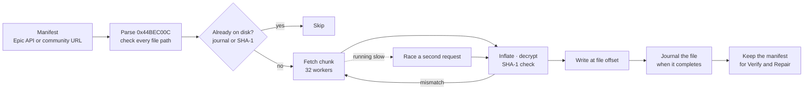

<div align="center">

<picture>
  <source media="(prefers-color-scheme: dark)" srcset="public/github_banner.png">
  <source media="(prefers-color-scheme: light)" srcset="public/banner_white.png">
  
</picture>

### The game launcher that downloads like it means it.

A native Epic Games and Steam launcher written from scratch in Rust: binary manifests, parallel chunk streams,<br>
SHA-1 on every chunk, and repairs that fetch only what is broken. No Python, no CLI wrapper, no store client.

<br>

[](https://github.com/xsunzukz/Hyperion/releases/latest)
[](https://github.com/xsunzukz/Hyperion/releases/latest)
[](#build-from-source)
[](LICENSE)

[](https://www.rust-lang.org/)
[](https://tauri.app/)
[](https://react.dev/)
[](https://www.typescriptlang.org/)

**[Get started](#-get-started)** · **[Features](#-features)** · **[Dauntless](#-dauntless-community-build)** · **[How downloads work](#-how-downloads-work)** · **[Security](#-security--antivirus)** · **[FAQ](#-faq)** · **[Build](#-build-from-source)**

</div>

<br>

> [!NOTE]
> Hyperion talks to Epic's services directly. It parses the binary manifest format, streams content chunks in parallel, decrypts and inflates them, checks every chunk against its SHA-1, and assembles files at their absolute offsets — all in Rust, with a Tauri 2 shell and a React 19 interface. **Every byte on disk arrives through code in this repository.**

<br>

## 🚀 Get started

1. **Download** `Hyperion_<version>_x64-setup.exe` from the [latest release](https://github.com/xsunzukz/Hyperion/releases/latest). Prefer no installer? Take the `_standalone.exe`; managed machines can use the `.msi`.
2. **Run it.** The build is not code-signed yet, so Windows SmartScreen asks first: choose **More info → Run anyway**.
3. **Sign in with Epic.** Epic's own login page opens; Hyperion never sees your password.
4. **Install.** Pick a game from your library — or hit **INSTALL** on the featured Dauntless banner.

Closing the window parks Hyperion in the system tray, where downloads keep running. Use **Quit Hyperion** in the tray menu to exit.

<br>

## ✨ Features

<table>
<tr>
<td width="50%" valign="top">

### ⚡ Download engine

- **32 parallel chunk workers** by default, up to 64 in Settings
- **Stall-proof:** a transfer that goes quiet for 15 s is dropped and retried, and a chunk running far slower than usual is **raced by a second request** — the first good copy wins
- **SHA-1 on every chunk** before a single byte is written; bad chunks are fetched again
- Streaming zlib inflate and AES-256-GCM decryption on the blocking pool, so the network never waits on the CPU
- **Crash-safe resume:** finished files are journaled as they complete, so a crash, kill or power cut picks up where it stopped
- **Smart updates:** a new build downloads only the files that changed and removes the ones it dropped
- CDN resolution: cached catalog → Epic assets API → manifest folder, each candidate probed before use
- Live MB/s and ETA averaged over 5 seconds, streamed from the Rust core

</td>
<td width="50%" valign="top">

### 🎮 Launcher

- Epic sign-in through Epic's own web login, renewed automatically while the app runs
- **Verify** an install against the exact build it came from, then **Repair** only the files that fail
- Launch, stop, cloud-sync and uninstall from one place
- **Stop a running game**, even one started outside the launcher
- **System tray** with a live menu: active downloads with percent, speed and ETA, and every installed game one click from launch
- Cloud saves with `{installdir}`, `{epicid}`, `{appdata}`, `{userdir}` path templates
- Steam downloads in-app through Valve's SteamCMD — no Steam client window
- Local state in SQLite; single instance; works offline with the last-known library

</td>
</tr>
<tr>
<td width="50%" valign="top">

### 🛡️ Safe by design

- **Uninstall deletes only the game's own files** — saves and mods you added stay
- Never installs into a library root or someone else's folder; whole-folder deletes refuse drive roots, system folders and folders holding other games
- Manifest file names are checked: nothing can be written outside the install folder
- Your Epic token is sent only to Epic's own servers, never to mirrors

</td>
<td width="50%" valign="top">

### 🖥️ Interface

- React 19 + Tailwind, dark glass styling
- Collapsible icon rail (`Ctrl+B`, remembered), grid and list views
- Search, installed/uninstalled and Epic/Steam filters
- Real progress events from the Rust core, not polled guesses
- Staged startup splash with a "continue anyway" escape hatch

</td>
</tr>
</table>

<br>

## 🗡️ Dauntless community build

<div align="center">
  
</div>

<br>

Hyperion features the **Mystic Paradox Dauntless 1.14.7 community build**, the first card on the Home screen.

- **INSTALL** opens the Direct Downloader with the build's manifest filled in, freshly fetched, and checks it before anything downloads.
- The game data comes from Epic's CDN, so **sign in with Epic first**. About **15 GB** to download.
- It installs under Epic's codename `Jackal` and shows up in your library as **Dauntless**.
- **Verify** and **Repair** work against the exact build you installed, so a broken file costs a re-download of that file, not the game.

<br>

## 🔬 How downloads work



Speed is a sum of small decisions, not one magic knob:

| Decision | Why it matters |
|---|---|
| Slow chunks are raced; silent transfers are dropped after 15 s | Epic's CDN leaves some chunks of older builds hanging for minutes. Racing them took a 200 Mbit line from **0.5–6 MiB/s to 17 MiB/s**, worst chunk from 505 s to 10 s |
| 32 chunk workers by default | High-latency routes need concurrency, not a bigger single stream |
| Decode and writes run on `spawn_blocking` | CPU work never starves the async runtime |
| 10 s connect / 15 s idle / 90 s total timeouts | A slow-but-flowing chunk keeps going; a silent one is retried |
| `tcp_nodelay`, keepalive, 64-connection idle pool | No per-chunk handshake or Nagle stalls |
| Absolute-offset writes, one handle per worker | No shared cursor, no seek contention between writers |
| Hash-checked resume journal | Resumes skip finished files without re-reading gigabytes |

<details>
<summary><b>Protocol notes</b></summary>

<br>

- **Manifests** are the binary `0x44BEC00C` format: a chunk data list (GUID, rolling hash, SHA-1, window size) plus a file manifest list whose parts reference chunk GUIDs with `offset` / `size` / `file_offset`. JSON manifests are read too.
- **Chunks** are `0xB1FE3AA2` containers. The header carries a version, compressed size, 128-bit GUID, rolling hash, SHA-1, `stored_as` flags and, from version 4, a secret GUID plus a 16-byte GCM tag.
- `stored_as` bit 0 means zlib-compressed, bit 1 AES-256-GCM encrypted; the nonce is the first 12 bytes of the chunk's SHA-1.
- The manifest's chunk SHA-1 is the hash of the **uncompressed** window, which is what every downloaded chunk is checked against.
- Files are pre-sized with `set_len`, then every chunk slice is written at its absolute `file_offset`.
- Each finished install keeps its manifest in `%LOCALAPPDATA%\Hyperion\installed`, which Verify, Repair, updates and uninstall work from.

</details>

<br>

## ✅ Verify, repair and updates

| Action | What happens |
|---|---|
| **Verify** | Hashes every file against the manifest the game was installed from — not whatever is published today |
| **Repair** | Verifies, then re-downloads only the missing and corrupt files |
| **Update** | Installs into the same folder: unchanged files are skipped, changed ones re-downloaded, removed ones deleted |
| **Cancel** | Removes a fresh install's partial folder; an existing install is never touched |
| **Uninstall** | Deletes the files the manifest lists and the folders left empty; anything you added stays |

<br>

## 🎮 Steam integration

Steam *downloads* run inside Hyperion — no Steam client window, no Steam library involvement — by driving Valve's headless **SteamCMD**, with speed, progress, ETA and validation streamed into the Downloads queue.

- SteamCMD is fetched into `%LOCALAPPDATA%\Hyperion\steamcmd` **the first time you open the Steam sign-in**, and set up while you type so the first login doesn't time out inside the Steam Guard window.
- Credentials are verified with Valve *before* anything is stored, and live in **process memory only**. "Remember on this PC" (off by default) keeps a DPAPI-encrypted copy instead.
- SteamCMD caches its own session after one clean sign-in, so later downloads authenticate silently.
- Listing the Steam games already on this PC is **opt-in** (Settings, or the Library banner).

Unlike the Epic path, this one deliberately delegates to Valve's tool: a from-scratch client would have to reproduce the CM/protobuf protocol, ownership tickets and per-depot keys.

<br>

## 🔒 Security & antivirus

A launcher does several things antivirus heuristics dislike, so the choices here are deliberate and verifiable in the code:

| | |
|---|---|
| **Nothing is fetched or run at startup** | Opening the app downloads no executables and starts no child processes |
| **No shelling out** | No `taskkill`, `reg query`, `tar` or PowerShell. Games are stopped with `TerminateProcess`, archives unpacked in-process, folders and links opened with `ShellExecute`. The only programs Hyperion starts are your games and SteamCMD |
| **No account snooping** | The Steam client's `loginusers.vdf`, `ssfn*` and browser data are never read. Only SteamCMD's *own* config in Hyperion's folder is checked |
| **No persistence** | No services, scheduled tasks, startup entries or run keys |
| **No injection** | No `ReadProcessMemory`, `CreateRemoteThread`, `SetWindowsHookEx`, DLL injection or drivers |
| **Light process checks** | A known game PID is watched with `OpenProcess(SYNCHRONIZE)`; other running games are found by name, and only processes whose name matches an executable in that game's folder are opened |
| **SteamCMD** | Valve's own signed tool, downloaded only when you first use Steam. "Download an executable, then run it" is still a pattern scanners watch for — that is what it is |

> [!IMPORTANT]
> The build is **not code-signed yet**, so SmartScreen warns and some antivirus products are cautious with it. If yours flags Hyperion or `steamcmd.exe`, add an exclusion for the Hyperion install folder and `%LOCALAPPDATA%\Hyperion`, and please report the false positive.

<br>

## ❓ FAQ

<details>
<summary><b>The download speed jumps around — is something wrong?</b></summary>

<br>

Usually not. Epic's CDN serves most chunks in about a second but leaves some hanging; Hyperion races those, so the speed swings while the average stays high. On a slow or shared connection, lower the worker count in **Settings → Downloader**; on a fast one, try 48–64.

</details>

<details>
<summary><b>"Chunk CDN … does not serve this build"</b></summary>

<br>

The game data lives on Epic's CDN, which needs a signed-in session to locate it. Sign in with Epic and install again — finished files are kept and skipped.

</details>

<details>
<summary><b>Verify says there is no saved manifest</b></summary>

<br>

That copy was installed by an older version or another tool. Install it again **into the same folder**: files already correct are recognised by hash and skipped, and Verify works from then on.

</details>

<details>
<summary><b>Where does Hyperion keep its data?</b></summary>

<br>

Everything lives in `%LOCALAPPDATA%\Hyperion`: the SQLite database, cached and installed manifests, and SteamCMD if you use Steam. Games go wherever you install them.

</details>

<details>
<summary><b>Can I move from the legendary CLI?</b></summary>

<br>

Yes. In the install dialog, set the folder to the one legendary used: every file there is checked by hash, only missing or different files are downloaded, and from then on Hyperion verifies, repairs and updates the game.

</details>

<br>

## 🛠️ Build from source

**Prerequisites** — Node 18+, Rust 1.78+ (tested on 1.97.1), and a Windows, Linux or macOS desktop.

```bash
npm install                 # frontend deps
cd src-tauri && cargo test  # 68 Rust tests
cd .. && npm run tauri dev  # full native app
```

| Command | What it does |
|---|---|
| `npm run dev` | Browser preview against the mock IPC backend |
| `npm run tauri dev` | Real desktop app (Rust core + React UI) |
| `npm run tauri build` | Production installers via the Tauri bundler |

`package-lock.json` and `Cargo.lock` are committed so builds are reproducible. Line endings are normalised to LF; binary assets are excluded from that.

<details>
<summary><b>Project layout</b></summary>

<br>

```
hyperion/
├── src/                        React 19 + TypeScript frontend
│   ├── components/             Sidebar, Header, GameCard, GameDetailModal, DownloadsView,
│   │                           CustomManifestModal, CloudSavesView, SettingsView, LoginModal …
│   ├── lib/ipc.ts              Typed Tauri IPC + browser mock fallback
│   └── App.tsx                 Layout & state orchestration
│
└── src-tauri/src/              Rust core (Tauri 2)
    ├── api.rs                  Epic OAuth (auto-renewing), assets API, manifest fetch
    ├── manifest.rs             Binary manifest 0x44BEC00C — parser & serializer
    ├── manifest_cache.rs       Community manifest cache + per-install manifests
    ├── chunk.rs                Chunk container 0xB1FE3AA2 — inflate & AES-GCM
    ├── downloader.rs           Hedged, hash-checked, resumable chunk streamer
    ├── installer.rs            Verify, safe paths, safe uninstall
    ├── launcher.rs             Native process launch with Epic arguments
    ├── cloud_save.rs           Path templates & datastorage sync
    ├── storage.rs              SQLite persistence
    ├── secret.rs               DPAPI store for a remembered Steam login
    ├── tray.rs                 Live tray menu
    ├── winproc.rs              TerminateProcess + toolhelp process-tree walk
    └── steam/                  SteamCMD driver, library scanner, VDF parser
```

- Build output and local state (`node_modules/`, `dist/`, `src-tauri/target/`, `*.db`, `.env*`, `reference/`) are ignored.
- Branding is generated: `public/app logos.png` is the source sheet; `scripts/build_logo.py` and `scripts/build_icons.py` rebuild the logo and the Tauri icon set.

</details>

<br>

## ⚖️ Scope and disclaimer

Hyperion is an **unofficial, unaffiliated** project. It is not endorsed by, or connected to, Epic Games or Valve.

It is a **client**, not a store and not a DRM bypass: it signs in to *your* account and downloads from the publisher's own CDN. It includes no game content, no keys and no licence circumvention. The Direct Downloader installs builds from manifests you choose — only install builds you have the right to use. Protocol understanding is derived from the open-source [Legendary](https://github.com/legendary-gl/legendary) project by **derrod** (GPL-3.0-or-later).

<br>

## 🙌 Credits

| | |
|---|---|
| **Author** | [xsunzukz](https://github.com/xsunzukz) |
| **Contributors** | [pranav158](https://github.com/pranav158) |
| **Assistance** | DeepSeek Harness and Claude Code (AI coding agents) — breakdown in [CONTRIBUTORS.md](CONTRIBUTORS.md) |
| **Protocol research** | [Legendary](https://github.com/legendary-gl/legendary) by derrod |
| **Licence** | [AGPL-3.0-or-later](LICENSE) |

<div align="center">

<br>

**[⬆ back to top](#)** · Built with Rust, Tauri 2 and React — because the download pipeline was the fun part.

</div>
