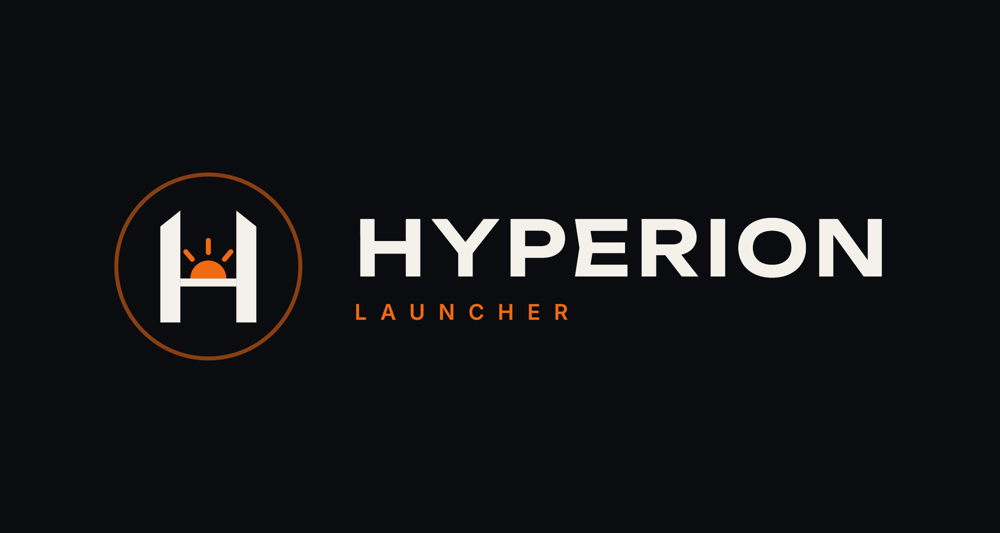
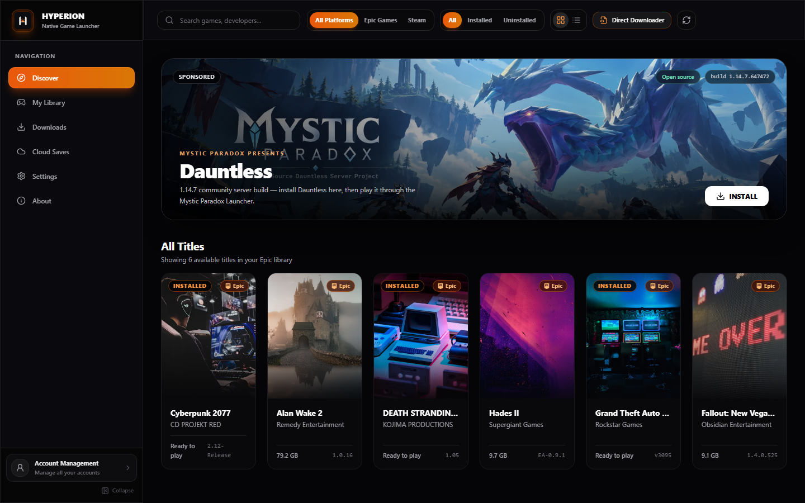
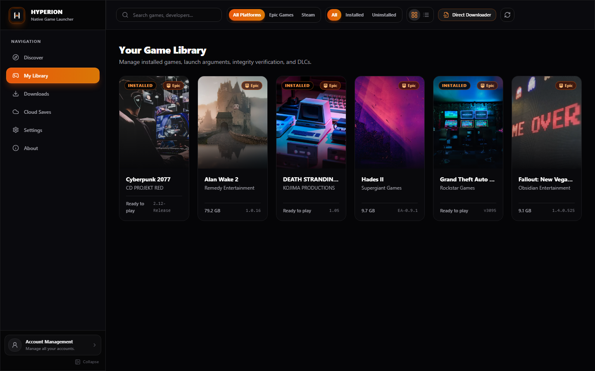
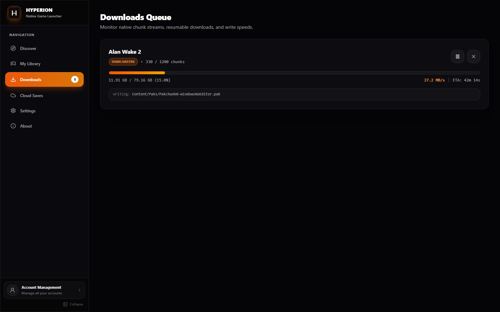
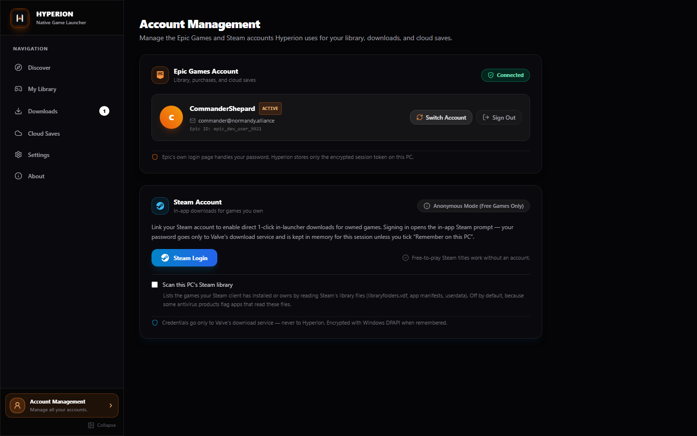
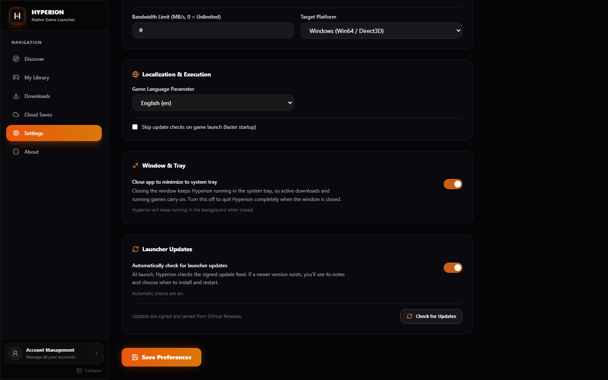
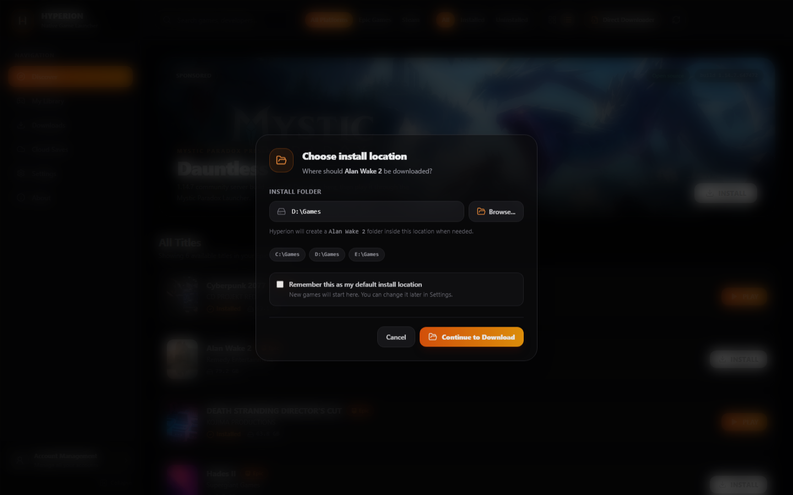
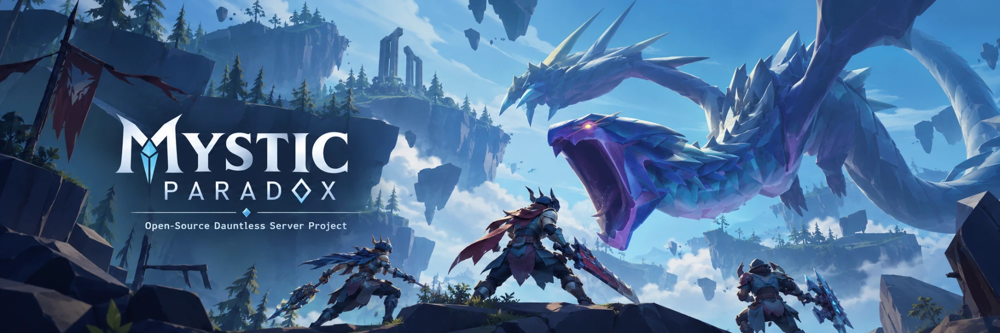

<picture>
  <source media="(prefers-color-scheme: dark)" srcset="public/github_banner.png">
  <source media="(prefers-color-scheme: light)" srcset="public/banner_white.png">
  
</picture>

### The game launcher that downloads like it means it.

**Your Epic Games and Steam libraries, in one clean place.** 
Install, verify, repair and play — with downloads that survive bad CDNs, crashes and restarts.

 

**[Download for Windows →](https://github.com/xsunzukz/Hyperion/releases/latest)** 
[Get started](#get-started) · [Screenshots](#a-look-inside) · [Features](#why-hyperion) · [FAQ](#faq) · [Developer guide](DEVELOPER.md)

 

The Discover screen — your whole library, featured builds, and one-click installs.

 

## Why Hyperion

<table>
<tr>
<td width="50%" valign="top">

### 🎮 Two libraries, one launcher

Sign in with Epic once. Connect Steam when you want in-app Steam downloads. Search, filter and launch everything without bouncing between clients.

</td>
<td width="50%" valign="top">

### ⚡ Downloads that keep going

Parallel chunks, automatic retries and crash-safe resume. A stalled CDN route no longer means starting a 70 GB download again.

</td>
</tr>
<tr>
<td width="50%" valign="top">

### ✅ Every byte checks out

Chunks are hash-checked before they reach disk. **Verify** finds the files that are actually broken, and **Repair** re-downloads only those.

</td>
<td width="50%" valign="top">

### 📁 Your installs stay yours

Every download asks where it should go, and you can remember that folder as your default. Keep your saves and mods; uninstall removes only the game's own files — never the folder around them.

</td>
</tr>
<tr>
<td width="50%" valign="top">

### 🖥️ Built to stay out of the way

A native Rust core and a fast, quiet interface. Close the window and downloads keep moving in the system tray — or turn that off in Settings.

</td>
<td width="50%" valign="top">

### 👤 Accounts in one place

Your Epic profile, Steam sign-in, Steam library scan and sign-out now live together in **Account Management**, not scattered through Settings.

</td>
</tr>
</table>

 

## A look inside

  <em>Real screenshots from the current build.</em>

<table>
<tr>
<td width="50%">
  
   
  <b>My Library</b> — grid or list, Epic and Steam side by side.
</td>
<td width="50%">
  
   
  <b>Downloads</b> — live speed, ETA, chunk progress and pause/cancel.
</td>
</tr>
<tr>
<td width="50%">
  
   
  <b>Account Management</b> — Epic and Steam accounts, together.
</td>
<td width="50%">
  
   
  <b>Settings</b> — worker count, install folder, language and tray behavior.
</td>
</tr>
</table>

 

  
   
  <b>Install location</b> — choose a folder, or remember it for future downloads.

 

## Get started

1. **Download** `Hyperion_<version>_x64-setup.exe` from the [latest release](https://github.com/xsunzukz/Hyperion/releases/latest). Prefer no installer? Grab the `_standalone.exe`; managed machines can use the `.msi`.
2. **Run it.** The build is not code-signed yet, so Windows SmartScreen asks first: choose **More info → Run anyway**.
3. **Sign in with Epic.** Epic's own login page opens; Hyperion never sees your password.
4. **Install and play.** Pick a game from your library and choose where it should go; tick **Remember** to use that folder for future downloads. For the featured Dauntless build, install the game here first; once it's installed, PLAY opens the Mystic Paradox Launcher, or sends you to its releases page if the launcher isn't installed.

Steam is optional. You only need it for Steam titles and in-app Steam downloads; your Epic library works without it.

> [!TIP]
> By default, closing the window keeps Hyperion running in the system tray so downloads finish. Prefer a normal exit? Turn off **Settings → Window & Tray → Close app to minimize to system tray**.

 

## ✨ Featured: Dauntless community build

  

 

Hyperion features the **Mystic Paradox Launcher** on the Discover screen.

- If Dauntless isn't installed, **INSTALL** downloads the 1.14.7 build through Hyperion.
- Once the game is installed, **PLAY** opens the Mystic Paradox Launcher.
- If the launcher isn't installed, **GET LAUNCHER** opens the [Mystic Paradox releases](https://github.com/pranav158/Mystic-Paradox/releases) page so you can download it.
- The launcher signs in, verifies your Dauntless install, keeps the runtime current, and launches the game.

 

## 🔒 Is it safe?

Hyperion is a client, not a store and not a DRM bypass. It signs in to **your** account and downloads from the publisher's own CDN.

- No background services, startup entries or scheduled tasks.
- No account snooping: Hyperion never reads the Steam client's saved logins or browser data.
- No shell commands or process injection. Games are stopped through the Windows API, not `taskkill`.
- Your Epic token goes only to Epic. Steam credentials go only to Valve's SteamCMD.
- Uninstall deletes only the files the game's manifest lists — saves and mods you added stay.

> [!IMPORTANT]
> Hyperion is **not code-signed yet**, so SmartScreen and some antivirus products may warn. If yours flags the app, add an exclusion for the Hyperion install folder and `%LOCALAPPDATA%\Hyperion`, and please report the false positive.

The full threat-model and antivirus notes are in the [developer guide](DEVELOPER.md#security-model).

 

## ❓ FAQ

<b>Is Hyperion free?</b>

 

Yes. Hyperion is open source under the [AGPL-3.0-or-later](LICENSE). There is no subscription, store or paid tier.

<b>Do I need both Epic and Steam accounts?</b>

 

No. Epic is the main path for your Epic library and the featured community build. Steam is optional: you can use it for free-to-play titles, or sign in to download games you own through Hyperion.

<b>Can I keep games I already installed with another launcher?</b>

 

Yes. Point Hyperion at the existing install folder. It hashes what is already there and only downloads missing or different files — then Verify, Repair and updates work from that point on.

<b>Does closing the window stop my download?</b>

 

Not by default. Hyperion keeps running in the system tray. If you would rather quit completely when the window closes, turn off **Close app to minimize to system tray** in Settings.

<b>Where does Hyperion store its data?</b>

 

App data, cached manifests and the local database live in `%LOCALAPPDATA%\Hyperion`. Games go wherever you choose during install. Your saves and mods stay in their own folders.

<b>Why does Windows SmartScreen warn me?</b>

 

The build is not code-signed yet. Choose **More info → Run anyway**. A code-signing certificate costs money and is not set up for this project yet.

 

## 🛠️ Under the hood

Hyperion has a native **Rust** core and a **React + TypeScript** interface, packaged with **Tauri 2**. It parses Epic's binary manifests, streams and verifies chunks, delegates Steam downloads to Valve's headless SteamCMD, and keeps its own state in SQLite.

Every byte written to disk goes through code in this repository. No Python, no CLI wrapper, no bundled store client.

**[Read the developer guide →](DEVELOPER.md)** — architecture, download pipeline, protocol notes, security model, build instructions and technical FAQ.

 

## ⚖️ Scope and disclaimer

Hyperion is an **unofficial, unaffiliated** project. It is not endorsed by, or connected to, Epic Games or Valve.

It is a **client**, not a store and not a DRM bypass: it signs in to *your* account and downloads from the publisher's own CDN. It includes no game content, no keys and no licence circumvention. The Direct Downloader installs builds from manifests you choose — only install builds you have the right to use.

Protocol understanding is derived from the open-source [Legendary](https://github.com/legendary-gl/legendary) project by **derrod**.

 

## 🙌 Credits

| | |
|---|---|
| **Author** | [xsunzukz](https://github.com/xsunzukz) |
| **Contributors** | [pranav158](https://github.com/pranav158) |
| **Assistance** | DeepSeek Harness and Claude Code (AI coding agents) — breakdown in [CONTRIBUTORS.md](CONTRIBUTORS.md) |
| **Protocol research** | [Legendary](https://github.com/legendary-gl/legendary) by derrod |
| **Licence** | [AGPL-3.0-or-later](LICENSE) |

 

**[⬆ back to top](#)** · Built with Rust, Tauri 2 and React — because the download pipeline was the fun part.

